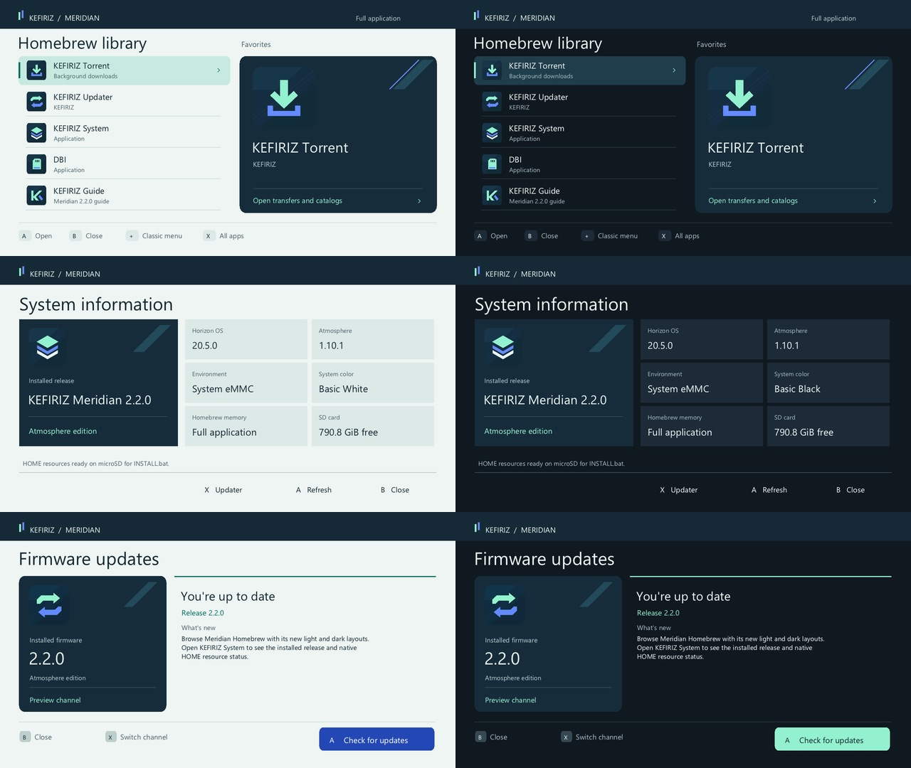

# KEFIRIZ Meridian

## Separate Linux desktop for Switch

**KEFIRIZ OS 0.2.0 Preview** adds a standalone X11 desktop, a versioned first-run guide and R + ZR Quick settings. Choose KEFIRIZ OS for programmable HOME buttons, Wi-Fi and background transfers. Choose Meridian for your installed Switch games. The ARM64 desktop has been exercised under QEMU. Physical console acceptance is pending. [Build kit](https://github.com/Stasan-minecraft/kefirjs-updates/releases/tag/kefiriz-os-v0.2.0) · [Desktop source and controls](kefiriz-os/README.md)

## Meridian for Switch games

**Ember** is an artwork update for Meridian 2.2.0 on Horizon 20.5.0. It adds a pearl-and-coral dock mark and a folded footer to native system screens. Windows builds the layouts from your own HOME export. The artwork installer can undo one revision. [Meridian Ember for Windows](https://github.com/Stasan-minecraft/kefirjs-updates/releases/tag/meridian-ember-v1)

**Meridian 2.2.0** is available on **Preview** for Horizon 20.5.0 and Atmosphère 1.10.1. The Windows installer builds a new gallery and three toolbar groups into Nintendo HOME from the resources on your card. Meridian includes a custom startup framebuffer for Atmosphère, new Homebrew, System and Updater interfaces, and original icons. Basic White and Basic Black control the system background and text. [Release notes](updates/atmosphere/native/full/2.2.0/README.md) · [Windows installer](https://github.com/Stasan-minecraft/kefirjs-updates/releases/download/atmosphere-v2.2.0/KEFIRIZ-Meridian-2.2.0.zip) · [Offline console update](https://github.com/Stasan-minecraft/kefirjs-updates/releases/download/atmosphere-v2.2.0/KEFIRIZ-Meridian-2.2.0-Offline.zip)

If your card is missing HOME resources, open **KEFIRIZ Homebrew** on the console and wait for the ready message. You can also check the result or retry in **KEFIRIZ System**. Power off, reconnect the microSD and run **install.bat**. On a card previously put into theme recovery, use **install.bat artwork** after a fresh capture.

**Installing from the console**. Update the independent edition to 2.0.3 on Stable. Reopen **KEFIRIZ Updater**, select Preview, then review and install Meridian. An older online updater first installs the 2.1.1 transition. Reopen it on Preview to continue to Meridian. The offline kit includes the current updater and applies the full release in one pass. Stable follows 2.0.3 for this edition and 1.2.3 for 786.

## Recover an earlier installation

**2168-0008 at boot with program 42000000004B4650 or 42000000004B4654.** Power off the Switch and extract the matching repair kit to the microSD root. It replaces both affected system modules before boot. Open the included updater after startup to finish the 2.0.2 or 1.2.2 recovery. [Atmosphère edition repair kit](https://github.com/Stasan-minecraft/kefirjs-updates/releases/download/atmosphere-v2.0.2/KEFIRJS-Repair-Atmosphere-2.0.2.zip) · [Legacy 786 repair kit](https://github.com/Stasan-minecraft/kefirjs-updates/releases/download/atmosphere-v2.0.2/KEFIRJS-Repair-786-1.2.2.zip)

**Boot crash after applying a theme?** Power off the console, unzip the recovery tool on Windows and run **KEFIRIZ-Theme-Recovery.cmd** with the microSD connected. It backs up the active theme files before the next boot. [Download theme recovery](https://github.com/Stasan-minecraft/kefirjs-updates/releases/download/atmosphere-v2.0.0/KEFIRIZ-Theme-Recovery.zip)

## Update from a phone

If the console cannot boot, open `config/kefiriz/release.txt` on the microSD. Its first line identifies the installed KEFIRIZ version and edition.

1. Download the repair ZIP for the edition already installed on the microSD. KEFIRIZ **2.0.x** uses the [Atmosphere edition repair kit](https://github.com/Stasan-minecraft/kefirjs-updates/releases/download/atmosphere-v2.0.2/KEFIRJS-Repair-Atmosphere-2.0.2.zip). KEFIRIZ **1.1.x** and **1.2.x** on Kefir 786 use the [786 repair kit](https://github.com/Stasan-minecraft/kefirjs-updates/releases/download/atmosphere-v2.0.2/KEFIRJS-Repair-786-1.2.2.zip).
2. Power off the Switch. Back up the microSD and extract the complete ZIP to its root. Accept replacement of the two system services and the updater. The service repairs take effect on the next boot.
3. Start the same CFW installation. Open **KEFIRIZ Updater** from Homebrew, select **Review update**, then **Install update**. The kit includes the signed release and works offline. Restart after installation to load the new components.

A running older updater can also install the bootstrap through GitHub. Reopen it after that first update and install the full native update. If the console cannot reach HOME, use the matching repair ZIP before boot.

## Install on a configured card

For the independent Atmosphere edition on Horizon 20.5.0, extract the full archive on a Windows PC and run **install.bat**. [Download the Meridian installer](https://github.com/Stasan-minecraft/kefirjs-updates/releases/download/atmosphere-v2.2.0/KEFIRIZ-Meridian-2.2.0.zip)

For a configured Kefir 786 card that has never had KEFIRIZ installed, first run the 1.2.0 Windows installer. Before booting, extract the 1.2.2 repair kit to the microSD. Boot your usual CFW, open the updater and install the signed update. [Legacy 1.2.0 full package](https://github.com/Stasan-minecraft/kefirjs-updates/releases/download/v1.2.0/KEFIRIZ-786-1.2.0.zip) · [1.2.2 repair kit](https://github.com/Stasan-minecraft/kefirjs-updates/releases/download/atmosphere-v2.0.2/KEFIRJS-Repair-786-1.2.2.zip)

## Open the updater after installation

| From | Action |
| --- | --- |
| KEFIRIZ Homebrew | Open **KEFIRIZ Updater** directly below Torrent. |
| Classic Homebrew Menu | Open the **KEFIRIZ Updater** application. |
| KEFIRIZ System | Press **X** or tap **Updater**. |
| Nintendo HOME | Hold **R + X** while starting an installed game with the standard title-override configuration. |
| A dedicated HOME tile | An existing forwarder-capable setup can point its own shortcut at the standalone NRO path above. The Windows installer does not register a Nintendo title. |

## Release files

Each release has its own folder under [updates](updates). It contains the release notes, signed metadata and on-console payload. The updater reads the signed stable feed, checks the installed edition, verifies each file, and records changes on the card.

The full Windows archive contains the source and component notices for that build. [Updater source](updater) · [Publishing the next release](tools/README.md) · [Release history](https://github.com/Stasan-minecraft/kefirjs-updates/releases)
