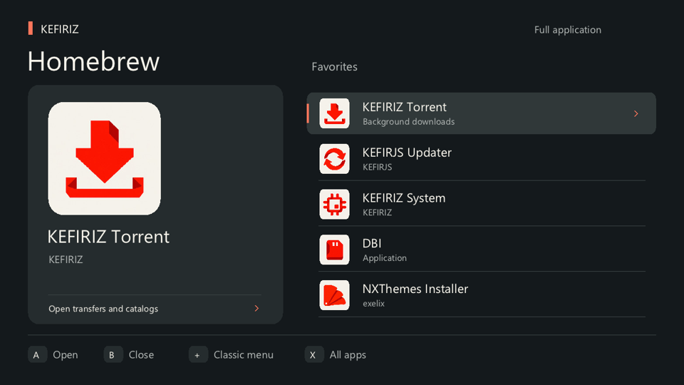
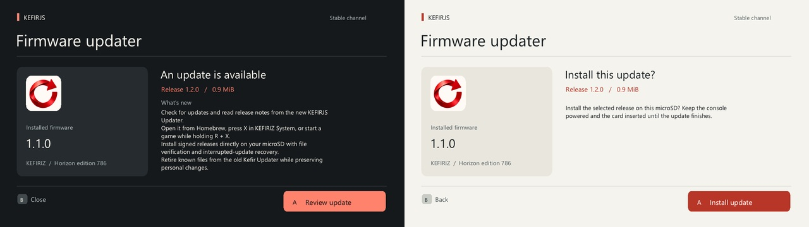

# KEFIRIZ · Switch updates

**[KEFIRIZ 2.0.2 · Atmosphère edition (hardware preview)](updates/atmosphere/native/2.0.2/README.md)** targets Horizon 20.5.0 and official Atmosphère 1.10.1. [Complete Windows installer](https://github.com/Stasan-minecraft/kefirjs-updates/releases/download/atmosphere-v2.0.2/KEFIRIZ-Atmosphere-2.0.2.zip)

**2168-0008 at boot with program 42000000004B4650 or 42000000004B4654.** Power off the Switch and extract the matching repair kit to the microSD root. It replaces both affected system modules before boot. Open the included KEFIRJS Updater after startup to finish installing the five Favorites, boot art and network fix. [Atmosphère edition repair kit](https://github.com/Stasan-minecraft/kefirjs-updates/releases/download/atmosphere-v2.0.2/KEFIRJS-Repair-Atmosphere-2.0.2.zip) · [Legacy 786 repair kit](https://github.com/Stasan-minecraft/kefirjs-updates/releases/download/atmosphere-v2.0.2/KEFIRJS-Repair-786-1.2.2.zip)

**Boot crash after applying a theme?** Power off the console, unzip the recovery tool on Windows and run **KEFIRIZ-Theme-Recovery.cmd** with the microSD connected. It backs up the active theme files before the next boot. [Download theme recovery](https://github.com/Stasan-minecraft/kefirjs-updates/releases/download/atmosphere-v2.0.0/KEFIRIZ-Theme-Recovery.zip)

## Update from a phone

If the console cannot boot, open `config/kefiriz/release.txt` on the microSD. Its first line identifies the installed KEFIRIZ version and edition.

1. Download the repair ZIP for the edition already installed on the microSD. KEFIRIZ **2.0.x** uses the [Atmosphere edition repair kit](https://github.com/Stasan-minecraft/kefirjs-updates/releases/download/atmosphere-v2.0.2/KEFIRJS-Repair-Atmosphere-2.0.2.zip). KEFIRIZ **1.1.x** and **1.2.x** on Kefir 786 use the [786 repair kit](https://github.com/Stasan-minecraft/kefirjs-updates/releases/download/atmosphere-v2.0.2/KEFIRJS-Repair-786-1.2.2.zip).
2. Power off the Switch. Back up the microSD and extract the complete ZIP to its root. Accept replacement of the two system services and the updater. The service repairs take effect on the next boot.
3. Start the same CFW installation. Open **KEFIRJS Updater** from Homebrew, select **Review update**, then **Install update**. The kit includes the signed release and works offline. Restart after installation to load the new components.

A running older updater can also install the bootstrap through GitHub. Reopen it after that first update and install the full native update. If the console cannot reach HOME, use the matching repair ZIP before boot.

## Install on a configured card

For the independent Atmosphere edition, extract the full archive on a Windows PC and run **install.bat**. [Download the 2.0.2 installer](https://github.com/Stasan-minecraft/kefirjs-updates/releases/download/atmosphere-v2.0.2/KEFIRIZ-Atmosphere-2.0.2.zip)

For a configured Kefir 786 card that has never had KEFIRIZ installed, first run the 1.2.0 Windows installer. Before booting, extract the 1.2.2 repair kit to the microSD. Boot your usual CFW, open the updater and install the signed update. [Legacy 1.2.0 full package](https://github.com/Stasan-minecraft/kefirjs-updates/releases/download/v1.2.0/KEFIRIZ-786-1.2.0.zip) · [1.2.2 repair kit](https://github.com/Stasan-minecraft/kefirjs-updates/releases/download/atmosphere-v2.0.2/KEFIRJS-Repair-786-1.2.2.zip)

## Open the updater after installation

| From | Action |
| --- | --- |
| KEFIRIZ Homebrew | Open **KEFIRJS Updater** directly below Torrent. |
| Classic Homebrew Menu | Open the **KEFIRJS Updater** application. |
| KEFIRIZ System | Press **X** or tap **Updater**. |
| Nintendo HOME | Hold **R + X** while starting an installed game with the standard title-override configuration. |
| A dedicated HOME tile | An existing forwarder-capable setup can point its own shortcut at the standalone NRO path above. The Windows installer does not register a Nintendo title. |

## Release files

Each release has its own folder under [updates](updates). It contains the release notes, signed metadata and on-console payload. The updater reads the signed stable feed, checks the installed edition, verifies each file, and records changes on the card.

The offline Windows archive contains the source and component notices for that build. [Updater source](updater) · [Publishing the next release](tools/README.md) · [Release history](https://github.com/Stasan-minecraft/kefirjs-updates/releases)
